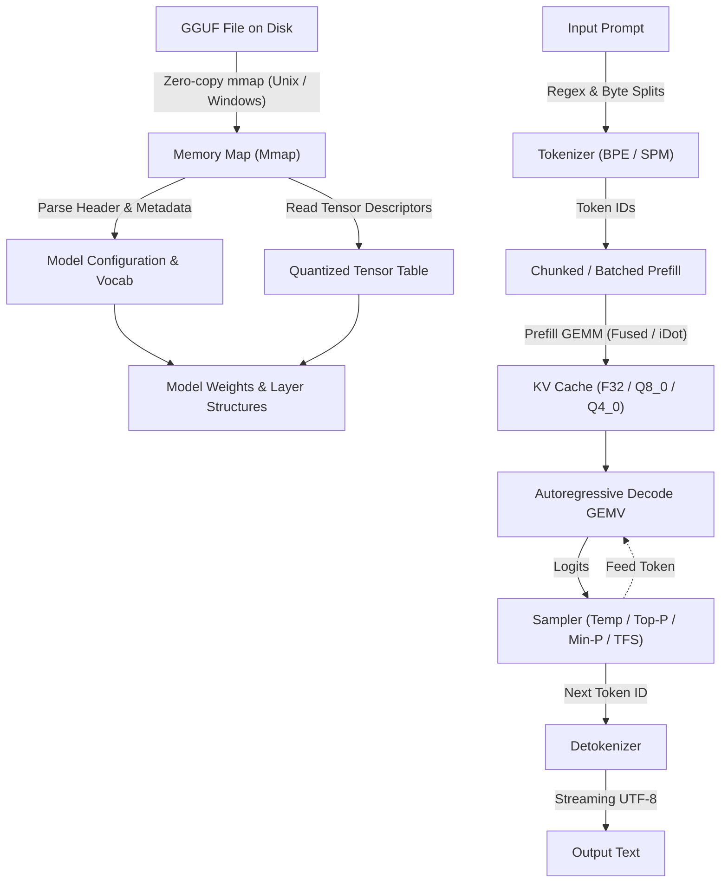

# Ferrite Architecture

Ferrite is an inference engine for transformer-based large language models written in pure Rust with zero external crate dependencies. This document explains the internal architecture, memory layout, compute kernels, and runtime execution pipeline.

## System Overview

## 1. Zero-Copy GGUF Storage and Memory Mapping

Ferrite avoids loading model weights into heap memory. A 16 GB model file is mapped directly into the virtual address space using platform-native operating system primitives:

- **Unix**: Direct `mmap` with `PROT_READ` and `MAP_SHARED` or `MAP_PRIVATE`.
- **Windows**: Direct `CreateFileMappingW` and `MapViewOfFile`.

Both syscall wrappers are declared inline within `src/map.rs` without dependencies on `memmap2` or `libc`.

### File Validation and Layout Safety

Every byte from disk is treated as untrusted input. The GGUF parser in `src/gguf.rs` enforces:
- Magic number verification (`GGUF` in little-endian format).
- Container version checks (versions 2 and 3 supported).
- Wire-size limits: string and array lengths are bounded against the remaining buffer to prevent unbounded allocation or loop execution on corrupted files.
- Arithmetic overflow checks: tensor offsets, alignments, and dimension strides use checked arithmetic to prevent forged offset slicing.
- Memory map boundaries: all tensor data offsets and byte lengths must lie strictly within the mapping range.

Weights remain in their quantized format inside the mapped pages until read during a matrix-vector or matrix-matrix multiplication.

## 2. Tokenizer Architecture

The tokenizer is reconstructed entirely from the GGUF file's embedded vocabulary metadata (`tokenizer.ggml.model` and related keys).

Ferrite implements two core tokenization paradigms:

### Byte-Pair Encoding (BPE)
Used by Llama 3, Qwen 2/2.5, DeepSeek, and Phi:
- Matches GPT-2 style regex pre-tokenization rules for splitting punctuation, contraction words, and whitespace runs.
- Maps text bytes through a 256-entry unicode byte representation.
- Computes iterative pair merges ordered by rank lookup.
- Respects literal special tokens (such as `<|im_start|>`, `<|im_end|>`, `<|eot_id|>`).

### SentencePiece (SPM)
Used by Llama 2, Mistral, and Gemma:
- Uses whitespace prefix replacement with `_` (`U+2581`).
- Evaluates vocabulary scores for subword pieces.
- Implements byte fallback via `<0xXX>` hex tokens when encountering out-of-vocabulary bytes.

## 3. Model Representation and Architecture Abstraction

The model representation in `src/model.rs` unifies transformer variants under a modular configuration. Ferrite supports 13 architecture identifiers:

- `llama`: Standard Llama 2, Llama 3, and derivatives.
- `qwen`, `qwen2`: Qwen models with attention QKV biases.
- `qwen2moe`, `qwen2_moe`: Qwen Mixture-of-Experts.
- `qwen2vl`, `qwen2_vl`: Vision-language architecture with Multimodal Rotary Position Embedding (M-RoPE).
- `gemma`, `gemma2`: Embedding scaling (`* sqrt(dim)`), decoupled head dimension, attention logit soft-capping, final logit soft-capping, and 4-stage post-attention/post-FFN RMSNorms.
- `mixtral`: Sparse Mixture-of-Experts with Top-K softmax gating.
- `deepseek`, `deepseek2`, `deepseek3`: Multi-Head Latent Attention (MLA), Multi-Token Prediction (MTP), auxiliary-loss-free MoE routing, and FP8 block-wise quantization.

### Layer Architecture

Each transformer block comprises:
1. **Input Normalization**: RMSNorm (with configurable epsilon).
2. **Self-Attention**:
   - Query, Key, Value projections (supports Multi-Head Attention, Grouped-Query Attention, and Multi-Head Latent Attention).
   - Rotary Position Embedding (RoPE) applied to Q and K with configurable frequency base and scaling factors.
   - Attention score calculation with causal masking and optional soft-capping.
   - Attention output projection.
3. **Post-Attention Normalization**: Optional (e.g. Gemma 2).
4. **Feed-Forward Network (FFN)**:
   - SwiGLU FFN: `gate_proj(x) * swish * up_proj(x)` followed by `down_proj`.
   - MoE FFN: Router gate directing inputs to selected top-K expert networks.
5. **Post-FFN Normalization**: Optional (e.g. Gemma 2).
6. **Residual Connections**: Exact floating-point accumulation across blocks.

## 4. Compute Engine and Quantization Kernels

Ferrite evaluates neural network layers through specialized kernels designed for CPU execution.

### Quantization Formats

Ferrite decodes and evaluates the following block formats:
- **Floating point**: `F32`, `F16`, `BF16`.
- **Legacy quants**: `Q4_0`, `Q4_1`, `Q5_0`, `Q5_1`, `Q8_0`, `Q8_1`.
- **K-quants**: `Q2_K`, `Q3_K`, `Q4_K`, `Q5_K`, `Q6_K`, `Q8_K`.
- **Microscaling / FP8**: `F8_E4M3` block-wise quantization.

### Execution Strategies

1. **Unfused Reference**: Dequantizes weight blocks into a temporary F32 buffer, then executes an F32 dot product. Used as the ground-truth numerical reference in test suites.
2. **Fused Dequantize-and-Dot**: Combines weight block scale/min unpacking and multiply-accumulate operations in a single streaming pass through cache.
3. **Integer Dot Product (iDot)**: Quantizes the incoming F32 activation vector into INT8 blocks once per layer, then accumulates products into 32-bit integers (`i32`). This delivers high speedups on `Q8_0` and `Q4_K`.
4. **Hardware SIMD Vectorization**:
   - **AVX2 / FMA**: 256-bit vector registers on x86_64, using integer multiply-add instructions (`_mm256_maddubs_epi16`, `_mm256_madd_epi16`).
   - **AVX-512**: 512-bit vector registers on supported x86_64 CPUs.
   - **ARM NEON**: 128-bit vector registers on aarch64.

## 5. Prefill and Decode Processing

Prompt processing is split into two phases:

### Chunked and Batched Prefill
During prompt ingestion, the tokens are evaluated in parallel chunks (default chunk size 512):
- Transforms memory-bandwidth-bound matrix-vector products (GEMV) into compute-bound matrix-matrix products (GEMM).
- Evaluates weight rows against multiple token activations simultaneously.
- Populates the Key-Value (KV) cache for all prompt tokens.

### Autoregressive Decode
During generation, one token is produced per step:
- Loads previous Key-Value states from the cache.
- Computes attention only for the newest token against all historical keys and values.
- Multi-threaded worker pool distributes weight rows across available CPU cores.

## 6. KV Cache Architectures

Ferrite provides three KV cache management strategies:
1. **Contiguous Cache**: Pre-allocated ring buffer in `src/kv.rs`, supporting `F32`, `Q8_0`, and `Q4_0` quantized representations to reduce memory footprint.
2. **PagedAttention**: Paged block table allocation in `src/paged.rs`, supporting shared prompt prefixes, copy-on-write branching, and dynamic sequence growth without memory fragmentation.
3. **Radix Tree Prefix Cache**: LRU radix cache in `src/prefix.rs` that retains token sequence activations across independent chat turns or requests.

## 7. Speculative Decoding and Advanced Sampling

To accelerate generation on memory-bound CPU architectures:
- **Draft-Target Speculative Engine**: Generates $K$ candidate tokens with a smaller draft model (e.g. 0.5B) and verifies them in parallel in a single forward pass of the target model.
- **Speculative Tree Decoding**: Explores branching candidate token sequences to improve acceptance rates.
- **DeepSeek Multi-Token Prediction (MTP)**: Evaluates specialized next-token predictor modules with rollback recovery.
- **Grammar-Constrained Sampling**: Enforces JSON schemas, regex patterns, or formal CFG grammars by masking invalid token logits prior to sampling.
